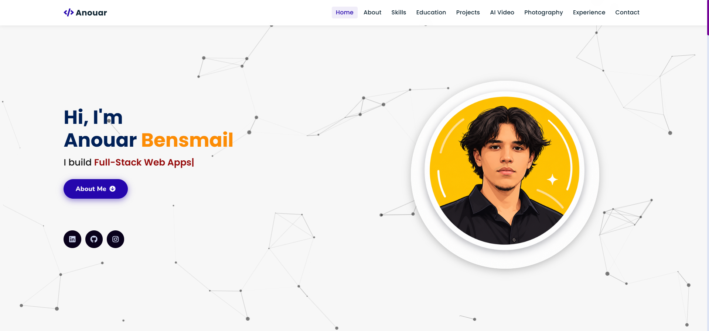
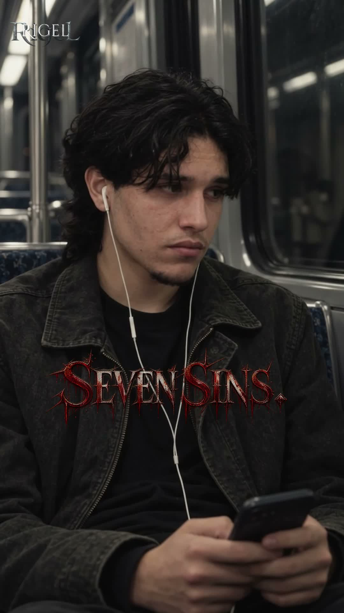
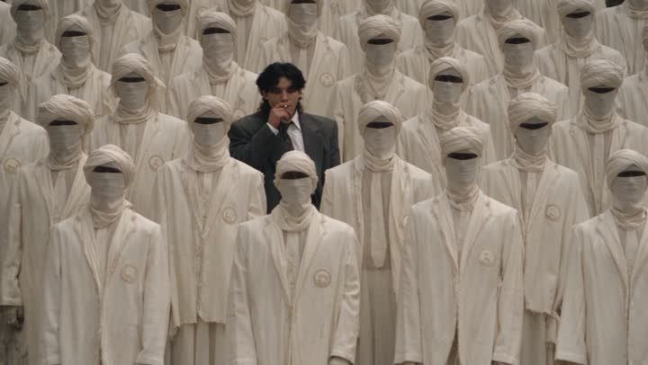
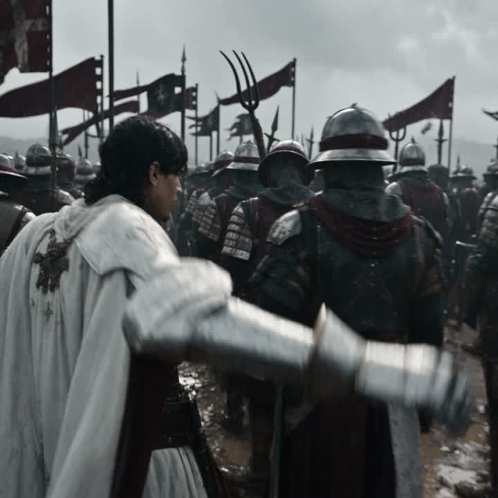

# Anouar Bensmail — AI Video Creator & Software Development Portfolio

<div align="center">



### **AI Video Creator · Cinematic Storytelling · Social Media Content · Software Development**

📍 Marrakech, Morocco &nbsp;|&nbsp; Currently at Peritus Legal Solutions (UK)

[](https://www.linkedin.com/in/rigel-anouar-8005a1343/)
[](https://github.com/Rigel-anouar)
[](mailto:anouar.bensmail26@gmail.com)

[**🌐 Live Portfolio**](https://rigel-anouar.github.io/Portfolio/) &nbsp;|&nbsp; [**📄 View CV**](https://rigel-anouar.github.io/Portfolio/cv.html)

</div>

---

## 👤 About Me

I'm **Anouar Bensmail**, known creatively as **Rigel** — an AI Video Creator and Software Development Technician based in Marrakech, Morocco.

I combine two professional strengths:

**Creative** — AI-powered video production, cinematic visual storytelling, generative AI tools, creative direction and short-form social media content creation.

**Technical** — Full-stack software development, Python automation, AI-powered APIs and practical digital solutions.

My current professional direction is AI video creation and content production, while my technical background in software development remains an active and important part of my identity.

---

## 🎬 Featured AI Cinematic Project

<div align="center">



### THERE WERE SEVEN SINS. I BECAME THE EIGHTH.

**AI Cinematic Video · Original Creative Concept**

> An original dark cinematic AI short featuring a solitary figure in a subway, a blood-red "SEVEN SINS" title overlay and the RIGEL creative brand. A tense, atmospheric visual narrative built entirely through AI-assisted generation, creative direction and cinematic editing.

🎯 **50.7K+ views** reached in approximately **one week** after publication — and still growing at last check on November 1, 2026.

> ⚠️ This achievement belongs to my **personal creative project**, not to Peritus Legal Solutions.

[▶ Watch on the live portfolio](https://rigel-anouar.github.io/Portfolio/#ai-video)

</div>

---

## 🎥 AI Video Projects

| Project | Visual | Description | Tools |
|---------|--------|-------------|-------|
| **There Were Seven Sins. I Became The Eighth.** |  | Dark cinematic vertical short — lone protagonist on a metro, atmospheric horror title overlay, RIGEL branding. ~59 seconds. **50.7K+ views in ~1 week.** | Flow Omni 1.1 Flash, CapCut |
| **One Among the Faceless** |  | Surreal AI short — a figure in a dark suit standing at the centre of a vast crowd of faceless white-robed figures. Visual meditation on identity and conformity. ~28 seconds. | AI Video Generation, CapCut |
| **The Last Crusade** |  | Epic dark fantasy cinematic — a young commander in a white crusader cloak leads a vast armored medieval army through a storm-lit battlefield. ~29 seconds. | AI Video Generation, CapCut |

---

## 🎞 Personal Cinematic Project — In Development

### THE PAPER BOAT — *We Were Going to See the World*

**Status: 🔧 IN DEVELOPMENT**

> "An original cinematic short film exploring childhood dreams, nostalgia and forgotten ambitions through the story of a handmade paper boat and a journey back to the past."

This project is not yet published. No views or performance metrics apply to this film.

---

## 🛠 Creative Tools & Technologies

### 🎬 AI Video Generation
`Flow Omni 1.1 Flash` &nbsp; `Higgsfield` &nbsp; `Higgsfield Genjutsu` &nbsp; `Kling AI`

### 🖼 AI Image Generation
`Leonardo AI` &nbsp; `Meta AI` &nbsp; `Gemini` &nbsp; `ChatGPT`

### ✂️ Video Editing
`CapCut`

### 🎨 Creative Skills
`Visual Storytelling` &nbsp; `Creative Direction` &nbsp; `Prompt Engineering` &nbsp; `Cinematic Scene Planning` &nbsp; `AI Video Production` &nbsp; `Short-Form Social Media Content`

---

## 💻 Software Development

### Portfolio Tech Stack
- **Frontend**: HTML5, CSS3 (Custom Properties), JavaScript (ES6), jQuery
- **Libraries**: Particles.js, Typed.js, Vanilla Tilt.js, ScrollReveal
- **Icons & Typography**: Font Awesome 5, Google Fonts (Poppins & Nunito)

### Developer Skills
- **Languages**: Python · JavaScript (ES6) · HTML5 · CSS3
- **Frameworks & Backends**: FastAPI · Flask · Django · Next.js · Bootstrap 5 · Jinja2
- **AI & Data**: PyTorch · CUDA · Prompt Engineering · openpyxl
- **Databases**: MySQL · SQLite
- **Tools**: Git · Selenium WebDriver · CustomTkinter

---

## 🚀 Software Development Projects

### 1. EduSystem Alpha — School Management Platform *(PFE)*
Full-stack web application built as my final year project with MVC architecture, secure authentication (bcrypt + RBAC) across 4 user profiles, and an 8-table MySQL relational database.

- **Autonomous DB Optimizer**: monitors MySQL `PERFORMANCE_SCHEMA`, detects SQL anti-patterns, generates recommendations through a 3-layer engine (index detection, query rewrite, impact prediction).
- Dual LLM backend (local Ollama + cloud Groq with fallback). Validated across 58 test cases.
- **Tech**: `Python` `Flask` `MySQL` `Jinja2` `Bootstrap 5` `Groq/LLM` `bcrypt`

---

### 2. BEAT FORGE — Local AI Music Generator
Real-time AI music generation API with CUDA acceleration, structured prompt intelligence, multi-candidate pipeline with heuristic scoring, and long-form audio rendering with crossfade mastering.

- **Tech**: `FastAPI` `PyTorch` `Meta MusicGen` `Next.js` `CUDA`

---

### 3. RIGEL — New Tab Chrome Extension
Custom Chrome new tab replacing the default page with an immersive space UI — animated starfield via Canvas API, intelligent URL/search detection, real-time clock, adaptive background theming, glassmorphism design. Full Manifest V3 compliance.

- **Tech**: `HTML5` `CSS3` `JavaScript (ES6)` `Canvas API` `LocalStorage` `Chrome MV3`

---

### 4. Instagram Automation Tool
Desktop application automating Instagram subscription management via Selenium WebDriver, with secure session persistence, modern CustomTkinter dark UI, multithreaded execution, and structured session logging.

- **Tech**: `Python` `Selenium WebDriver` `CustomTkinter` `Multithreading`

---

### 5. Professional Portfolio Website
This portfolio — a custom responsive personal website featuring particle animations, scroll reveal effects, 3D card tilt physics and a working contact form.

- **Tech**: `HTML5` `CSS3` `JavaScript` `Bootstrap`

---

## 💼 Professional Experience

### AI Video Creator & Social Media Content Creator
**Peritus Legal Solutions** — UK-based · Marrakech, Morocco | *2026 – Present*

Creating AI-powered video content for social media platforms, developing creative concepts and visual storytelling, and producing short-form videos for TikTok, Instagram Reels and YouTube Shorts using AI generation tools and video editing software.

---

### Stagiaire Développeur en Automatisation
**Tectra** — Marrakech, Morocco | *2025*

Built an automated Python tool to extract identity and administrative data from PDF documents and generate structured Excel reports via `openpyxl`.

- **Tech**: `Python` `openpyxl` `PDF Parsing` `Excel Automation`

---

## 🎓 Education

| Diploma | Institution | Period | Status |
|---------|------------|--------|--------|
| **Technicien Spécialisé en Développement Informatique** (Web & Logiciel) | École Racine — Marrakech | 2024 – 2026 | ✅ Obtained October 2026 |
| **Baccalauréat Sciences Physiques** | Lycée Chkili — Marrakech | 2022 – 2023 | ✅ Completed |

---

## 🌐 Languages

| Language | Level |
|----------|-------|
| Arabic | Native |
| English | B1 / Intermediate |
| French | Basic |
| German | Beginner — currently learning |

---

## 📁 Local Development

This is a static HTML/CSS/JS website — no build tools or package manager required.

```bash
# 1. Clone the repository
git clone https://github.com/Rigel-anouar/Portfolio.git
cd Portfolio

# 2. Open directly in browser
#    Double-click index.html
#    — OR — serve with a local static server:
npx serve .
# Then open: http://localhost:3000

# 3. For video playback, use a local server
#    (browsers block local file:// video in some cases)
```

**Project structure:**
```
Portfolio/
├── index.html          # Main page
├── cv.html             # Interactive CV (print-to-PDF)
├── 404.html            # Custom 404 page
├── assets/
│   ├── css/style.css   # All styles
│   ├── js/script.js    # Main JS (Typed.js, EmailJS, ScrollReveal)
│   └── images/
├── photo/
│   ├── vedio/          # AI video files + posters
│   ├── img/            # Photography gallery
│   └── me.jpeg         # Profile photo
└── projects/           # Extended projects page
```

---

## 📬 Contact

- **Email**: [anouar.bensmail26@gmail.com](mailto:anouar.bensmail26@gmail.com)
- **Phone**: +212 771 845 747
- **LinkedIn**: [linkedin.com/in/rigel-anouar-8005a1343](https://www.linkedin.com/in/rigel-anouar-8005a1343/)
- **GitHub**: [github.com/Rigel-anouar](https://github.com/Rigel-anouar)
- **Location**: Marrakech, Morocco

---

<div align="center">
  <sub>Designed & Developed by Anouar Bensmail (Rigel) © 2026</sub>
</div>
